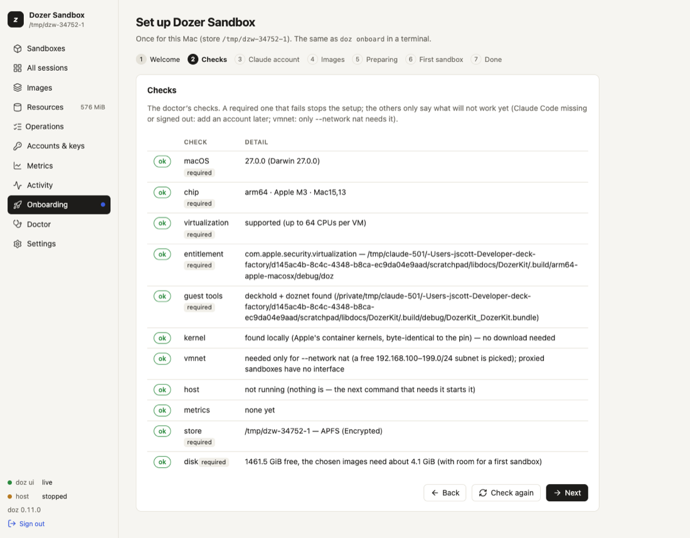

# Setting up this Mac

Setup — **onboarding** — is what you do once after installing: it checks your Mac, connects a Claude
account, writes your settings and prepares the images your sandboxes start from. You can do it in the
terminal (`doz onboard`) or in the browser (the dashboard's setup wizard). Both do exactly the same
thing, and both are safe to run again.

## Concepts

- **An image** is what a sandbox starts from: a prepared disk with Linux, a developer toolkit and,
  for the agent images, the agent. Preparing one downloads a base system and installs everything in a
  temporary VM — a few minutes, once. Every sandbox made from it is an instant copy. See
  [Images and bases](08-images-and-bases.md).
- **Preparation runs in the host**, not in your terminal. You can close the terminal or leave the
  wizard; it carries on. A sandbox started while its image is being prepared joins that preparation
  instead of starting another one.
- **An account** is how a sandbox's agent pays for its AI model: your Mac's Claude Code login, a
  long-lived token, or an API key. The secret stays on your Mac; a sandbox only ever sees a stand-in.
  See [Agents and accounts](09-agents-and-accounts.md).

## In the terminal

```sh
doz onboard
```

On a terminal it asks; **Enter** always accepts the recommended answer.

1. **Checks** — the same checks as `doz doctor`. The required ones stop setup when they fail: Apple
   silicon, macOS 26 or later, virtualization, the signed program, the store on an APFS disk with room
   for the chosen images, and a store path short enough. The rest only warn: Claude Code missing or
   signed out (you can add an account later), and the NAT network helper (only `--network nat`
   needs it).
2. **Claude account** — offered, never done behind your back:
   - **Use this Mac's login** (the default when Claude Code is signed in here);
   - **an API key** or **a setup token** (from `claude setup-token`), pasted at a hidden prompt,
     checked with one tiny request and stored in your login keychain, then made the default;
   - **Decide later** — nothing changes.
3. **Images** — Claude Code is prepared by default; pi and the lab shell are optional.
4. **Settings** — `doz.toml` (every setting at its default, plus your answers) and `agent-prompt.md`
   beside it, each written **only if it doesn't exist yet**.
5. **Preparing** — the Linux kernel, a small boot disk, the base system download and the install.
   Progress shows as steps (**Step 3 of 9**), with download bars and the last lines of the installer's
   output. Once this Mac has prepared an image, later preparations show time estimates.

   Press **Ctrl-C** to leave it running in the background. Then:

```sh
doz onboard --status      # show the images and follow a preparation that is running
doz onboard --cancel      # stop the images being prepared
```

When every chosen image is ready, the store is marked as set up — even if you'd detached.

### Without questions (scripts)

```sh
doz onboard --images claude-code,pi --account mac --yes
doz onboard --all-images --yes            # claude-code, pi and lab (15 minutes or more the first time)
doz onboard --no-images --account later --yes
doz onboard --account setup-token --account-name work --plan max --secret-stdin --yes < token.txt
```

`--yes`, `--json`, or no terminal: nothing is asked and the defaults are taken. A key or token is
read from standard input only with `--secret-stdin`; it is never a command-line argument.

| option | what it does |
|---|---|
| `--images LIST` | The images to prepare, comma-separated: `claude-code`, `pi`, `lab`. |
| `--all-images` · `--no-images` | All three · none now (each is prepared the first time it's used). |
| `--account mac\|api-key\|setup-token\|later` | Answer the account step (the Claude Code checks are then skipped). |
| `--account-name NAME` · `--plan PLAN` · `--force` | For a key or token: its name (default `work`), a token's plan (`max`, `pro`, `team`, `enterprise`), replace an existing account. |
| `--status` · `--cancel` | Follow · stop the preparation. |

## In the dashboard

```sh
doz ui
```

A store that was never set up opens on the **setup wizard**:

1. **Welcome**
2. **Checks** — updating live; a failing required check stops here, with **Check again**.
3. **Claude account** — this Mac's login when it is signed in; an API key or setup token in a masked
   field; or *Decide later*.
4. **Images** — a checklist with each image's download size, time estimate and disk space.
5. **Preparing** — a card per image with its progress. **Continue in the background** lets you use
   the dashboard meanwhile (the preparation shows under **Operations**); **Cancel preparation** stops
   it.
6. **First sandbox** (optional) — pick the agent; it suggests a name (`claude-sandbox`) and a project
   folder (`~/Developer/dozer-sandbox-projects/claude-sandbox`, made if it doesn't exist).
   **Choose…** opens the Mac's own folder picker. Or pick **Isolated** to share no folder.
7. **Done** — what was written where, and your **projects folder**
   (`~/Developer/dozer-sandbox-projects`): each new sandbox from **Quick add**, **New sandbox** or
   `doz new` gets its own folder there. **Settings** › **Choose…** moves it.



You can run the wizard again at any time: **Onboarding** in the sidebar (with a dot beside it until
the store is set up), or **Doctor** › **Run onboarding again**.

## What was written where

| what | where |
|---|---|
| Your settings | `~/.config/dozer-sandbox/doz.toml` (under `$XDG_CONFIG_HOME` if set) — see [Settings reference](15-settings-reference.md) |
| Your agent prompt template | `agent-prompt.md` beside it — everything inside an HTML comment, so it changes nothing until you write your own text. See [Agents and accounts](09-agents-and-accounts.md#the-agents-environment-facts) |
| The store (images, sandboxes) | `~/Library/Application Support/dozer-sandbox` |
| Accounts with a secret | your login keychain, `doz-claude:NAME` (tokens) or `doz-anthropic:NAME` (API keys) |

## Settings

| key | default | what it does |
|---|---|---|
| `defaults.image` | `lab` | The image `doz up NAME`, `doz init` and the dashboard's New sandbox use when you don't name one. Onboarding sets it to the image you chose. |
| `defaults.projects_dir` | `~/Developer/dozer-sandbox-projects` | Your projects folder: Quick add, `doz new` and New sandbox make each new sandbox's folder in it. `doz onboard` says where it is; the dashboard's **Settings** › **Choose…** or `doz config set defaults.projects_dir DIR` moves it. |
| `defaults.account` | `mac` | The account of a store that hasn't chosen one. `doz account default` decides for a store once it has. |
| `ui.allow_secret_entry` | `true` | The dashboard may take an API key or setup token in a masked field. `false`: it shows the `doz account add` command instead. The dashboard can turn this off, never on. |
| `images.claude_code_version` · `images.pi_version` | `latest` | Which agent version an image is prepared with. See [Agents and accounts](09-agents-and-accounts.md#agent-versions). |

## Limits and notes

- Setup never signs you in to Claude Code, and never touches Claude Code's own refresh token.
- Re-running `doz onboard` is safe: it re-checks, leaves existing settings files alone and prepares
  only what is missing.
- The first preparation needs the internet: it downloads a base system (about 380 MB for the Claude Code
  and pi images; `doz base ls` lists each base's download) and the agent.

## Troubleshooting

| symptom | what to do |
|---|---|
| A required check fails | Read its message; `doz doctor` shows every check with what to do. |
| Preparation fails part way | `doz onboard --status` shows the failed step with its last output lines. Run `doz onboard` again: it continues with what's missing. |
| "latest" can't be resolved (offline) | Set an exact agent version: `doz config set images.claude_code_version 2.1.227`. |
| The wizard shows commands instead of a key field | `ui.allow_secret_entry` is off: use `doz account add NAME --api-key` in a terminal. |
| You want to start over | [Uninstall](02-install-upgrade-uninstall.md#uninstall), then install and onboard again. |
