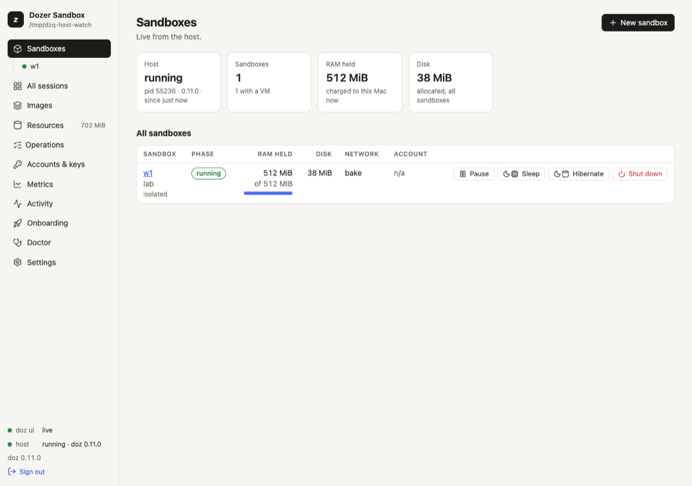
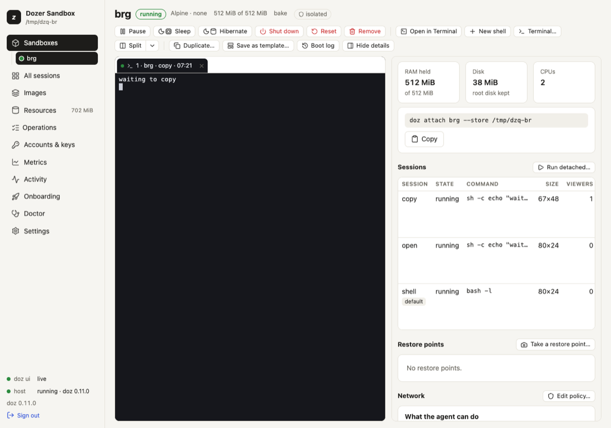
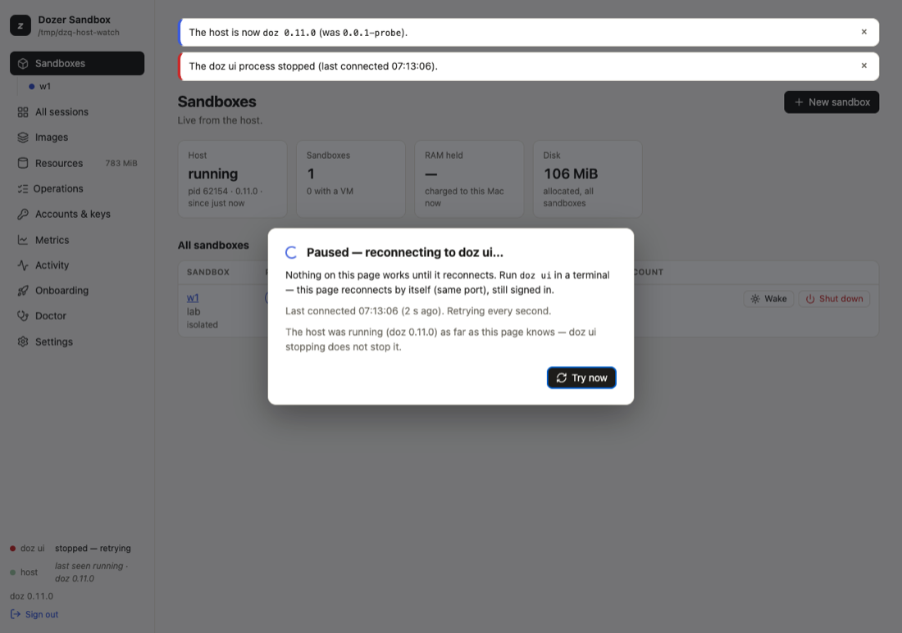

# The dashboard (`doz ui`)

`doz ui` is Dozer in your browser: every sandbox with a live terminal, its restore points and
permissions, your images, accounts, disk use and settings. It does almost everything the command line
does, and a few things are easier there — watching many sessions at once, or seeing what an agent was
refused and allowing it with one click. It runs on your Mac only; nothing else can reach it.

## Concepts

- **One dashboard per store.** Running `doz ui` again reuses the one that runs.
- **A one-use sign-in link.** `doz ui` opens your browser with a link that works **once**, for **five
  minutes**, and signs that browser in (until you sign out, or 12 hours without the page open). Nobody
  else can sign in without a link.
- **A client of the host**, like the command line. Opening the dashboard doesn't start the host;
  any action you take does, as a command would.

## Start it

```sh
doz ui                    # serve it and open it in your browser
doz ui --print-url        # print the link instead of opening a browser
doz ui link               # another browser or tab on the dashboard that runs
doz ui --new-link         # sign every page out and make a new link
```

Stop it with **Ctrl-C** in its terminal. The address is `http://127.0.0.1:PORT`: the port this store's
last dashboard used when it's free, so a page left open reconnects by itself — still signed in — when
you start `doz ui` again, and no new tab opens.

**When a tab opens:** only when none of the dashboard's pages is open (the setting `ui.open_browser`:
`auto`). Set it to `always` or `never`, or use `--open` / `--no-open` for one run.

Treat a printed link like a password: anyone with it can sign in to your dashboard for those five
minutes.

## The pages



| page | what it's for |
|---|---|
| **Sandboxes** | Every sandbox: state, RAM held, disk, network, account. **Quick add** (every default, started and opened — also the **+** beside **Sandboxes** in the sidebar; see [The quickest way](05-sandboxes-and-lifecycle.md#the-quickest-way-quick-add-and-doz-new)) and **New sandbox**. Under it in the sidebar, each sandbox has its own entry that opens **its page**. |
| **A sandbox's page** | A control bar (its state, image, RAM, network and refusals, account, the lifecycle buttons, **Open in Terminal**, **New shell**, **Terminal…**, **Split**, **Duplicate…**, **Save as template…**, **Boot log**) and its **terminals**, with a **details** panel beside them: sessions, restore points, **What the agent can do** and the connection log, keys and account, configuration. |
| **All sessions** | A grid of live, read-only tiles: every session of every running sandbox. Click a tile to open it. |
| **Images** | The images and templates, each image's agent version, what's out of date (**Rebuild**), disk shared and own, and the **Lineage** tree. |
| **Resources** | Every byte Dozer uses, and deleting what can go. See [Resources and disk space](13-resources-and-disk-space.md). |
| **Operations** | Every action the dashboard (or a preparation) started: live progress, time taken, result. A spinner shows while any runs, and a red dot when one failed since you last looked. |
| **Accounts & keys** | Your Claude accounts: add, verify, make default, remove, keep-alive. |
| **Metrics** | How long each kind of action takes (count, median, p90…), filtered by image and time; download as CSV. |
| **Activity** | What the host is doing, live. |
| **Onboarding** | The setup wizard, again. |
| **Doctor** | `doz doctor`'s checks, with **Run onboarding again**. |
| **Settings** | Every setting, its value, default and description, and where its value came from; change it in place. Folders on your Mac are never typed here: the projects folder has **Choose…**, your Mac's own folder picker; the others are set with `doz config set`. |



### Safety catches

**Reset**, **Remove**, **Revert** and every delete ask you to type the name first. **Shut down**
asks with a plain confirmation. Clicking an action again while it runs does nothing more.

## The host, watched

The sidebar's footer shows the dashboard's connection and the host's state and version.

- **The host stopped** (`doz host stop`, idle, or a clean quit): a banner says your sandboxes were
  hibernated, with **Start host**.
- **The host crashed or was killed:** a banner names the sandboxes that were running (they are shut
  down; start them again).
- **Another version of the host took over:** a banner says so. If the host is **older** than the
  dashboard, **Restart host** asks first, hibernates what runs and starts the newer host (sandboxes
  wake when you use them). If the dashboard is the older one, restart `doz ui`.

## When `doz ui` stops

A banner says so. After a moment the page is paused under an overlay: nothing behind it can be
clicked, and it says it is reconnecting, what to run, when it was last connected, and whether the host
was running, with **Try now**. The page retries every second and comes back by itself when you start
`doz ui` again (it says "doz ui restarted"). If the port changed, or after `--new-link`, it asks for a
new link: run `doz ui link`.



## Terminals in the browser

On a sandbox's page, **Open** attaches to a session, **Watch** shows it read-only, **New shell**
starts a new shell (`shell-2`, `shell-3`, …) and **Terminal…** attaches to any session or starts one
running a command. Terminals are tabs; **Split** shows two side by side. Closing a tab only closes the
view — the session keeps running. Each tab is titled like `1 · my-app · claude · 14:05` (the setting
`ui.terminal_title`). Details, including the mouse, paste and the clipboard, in
[Terminals and sessions](07-terminals-and-sessions.md#in-the-browser).

**Open in Terminal** opens the same session in your terminal app instead, via `doz attach`.

## Keys in the browser

With `ui.allow_secret_entry` on (the default), the wizard and **Accounts & keys** take an API key or
setup token in a masked field, sent once and stored exactly as `doz account add` stores it. A
sandbox's page can take a key of its own the same way. The dashboard never shows a secret: accounts
and keys appear as a state, a source and a fingerprint. Turn it off with
`doz config set ui.allow_secret_entry false` — the pages then show the commands instead. The
dashboard can switch this off but never on.

## Settings

| key | default | what it does |
|---|---|---|
| `ui.open_browser` | `auto` | When `doz ui` opens a tab: `auto` (only when no page is open), `always`, `never`. |
| `ui.theme` | `auto` | `auto` follows macOS; `light`; `dark`. |
| `ui.terminals` | `true` | Terminals in the browser. `false`: none open (Open in Terminal still works). |
| `ui.terminal_font_size` | `13` | Font size of a browser terminal (9–32). |
| `ui.terminal_title` | `{sandbox} · {session} · {time}` | A terminal tab's title (and your terminal's, in `doz attach`). |
| `ui.split_default` | `shell` | What **Split** opens: `shell`, `watch`, `attach` or `dialog`. |
| `ui.details_open` | `true` | A sandbox's page shows its details panel. |
| `ui.boot_view_on_start` | `true` | **Start** opens a terminal on the boot. |
| `ui.confirm_shutdown` | `true` | **Shut down** asks first. |
| `ui.grid_live_tiles` | `8` | All sessions: at most this many tiles live at once (1–12). |
| `ui.grid_tile_size` | `medium` | All sessions: `small`, `medium`, `large`. |
| `ui.progress` | `animated` | How starts and preparations show their progress: `animated` or `plain`. |
| `ui.allow_secret_entry` | `true` | The dashboard may take a key or token (see above). |

## Limits and security

- **Loopback only**, and every page, request and terminal checks the sign-in cookie, the exact host
  and origin, and a CSRF token on every change.
- **Terminals run in an isolated frame**: whatever a sandbox prints can never reach your dashboard
  session, its cookie or other terminals. Links in terminal output aren't clickable.
- The dashboard alone never keeps an idle host running; an open terminal does, as `doz attach` does.

## Troubleshooting

| symptom | what to do |
|---|---|
| "Sign in with a new link" | The link was used, expired, or every page was signed out: `doz ui link`. |
| A terminal says "Disconnected" | `doz ui` stopped, the browser signed out, or it was silent a long time. Reconnect, or `doz ui link`. |
| Two tabs open each time | Set `ui.open_browser` to `auto` (the default) or run `doz ui --no-open`. |
| Open in Terminal does nothing | Make a terminal app the handler for `.command` files: Finder › Get Info on any `.command` file › Open with › Change All… |
| "the resources are missing" | Reinstall: `brew reinstall doz`. |
