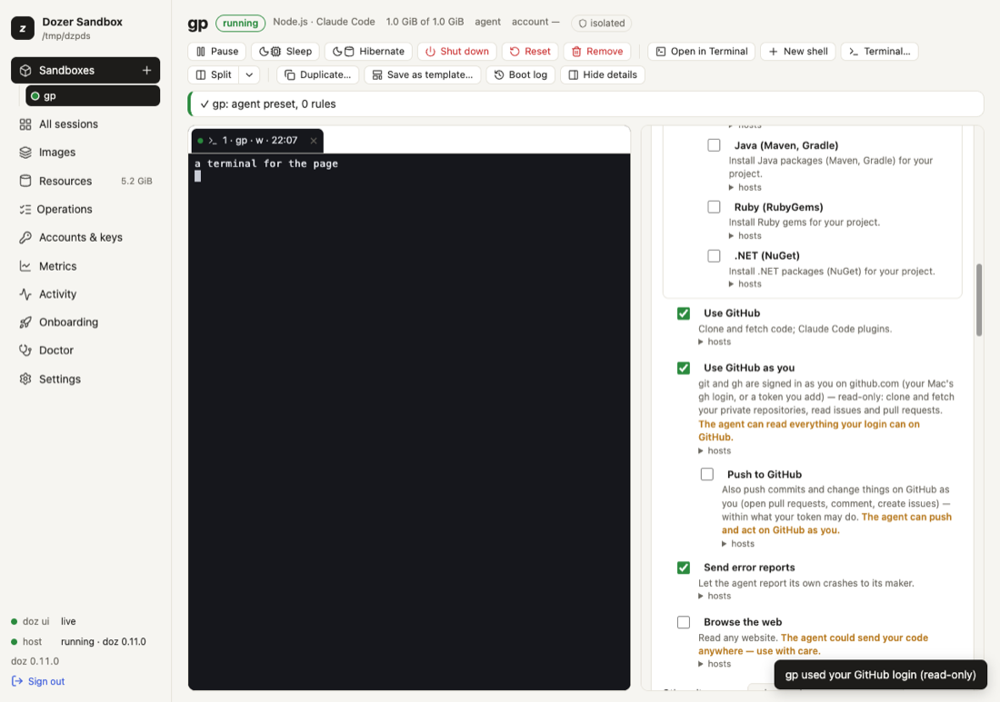

# GitHub as you

An agent on your Mac uses `git` and `gh` as you: it clones your private repositories, opens pull
requests, comments on issues. An agent in a sandbox can do the same — **without your token ever
entering the sandbox**. Dozer's proxy, on your Mac, puts your login into each request on its way to
GitHub, the same way it supplies the agent's AI credential.

It's **off** until you turn it on for a sandbox, and **read-only** until you also allow pushing.

## Concepts

- **Use GitHub as you** — a permission (in the sandbox's permissions, beside "Use GitHub"). While it's
  on, `git` and `gh` in the sandbox are signed in to github.com as you. Inside, `GH_TOKEN`,
  `GITHUB_TOKEN` and git's login hold only a **placeholder** (`doz_cred_…`); the proxy swaps your real
  token in on the way to `github.com`, `api.github.com`, `uploads.github.com` and `codeload.github.com`
  — and only there. A placeholder sent anywhere else is refused.
- **Read-only** (the default when it's on): clone, fetch, pull, `gh repo view`, reading issues and pull
  requests. **Refused**, with a message that says how to allow it: `git push`, and anything that changes
  something on GitHub — creating issues or pull requests, comments, edits, deletes, and GraphQL
  mutations.
- **Push to GitHub** — a second permission under the first: the agent can push and act on GitHub as you,
  within what your token may do. Every such request is in the sandbox's network log (method and path —
  never a body, never the token).
- **Where your token comes from** — the setting `github.credentials`:
  - `gh` (the default): your Mac's own `gh` login, read when it's used (`gh auth token`) and kept in
    the proxy's memory for a few minutes — never written anywhere. Signing out of `gh` on the Mac
    (`gh auth logout`) ends it.
  - `key`: only a token you give a sandbox yourself (below). A **fine-grained token** limited to the
    repositories the agent works on is the safest choice.
  - `off`: never, even with the permission on.
- **Your identity** — your `user.name` and `user.email` from the Mac's global git config are copied
  into the sandbox's git config (they're not secrets), so the agent's commits are yours. They're gone
  when you turn the permission off.

## Turn it on

In the dashboard: the sandbox's **Permissions** → **Use GitHub as you** (and **Push to GitHub** under
it). Each asks first.



From the command line:

```sh
doz net allow my-app github:as-you          # read-only
doz net allow my-app github:push            # also push (turns on github:as-you too)
doz net deny my-app github:push             # back to read-only
doz net deny my-app github:as-you           # off — every placeholder already issued stops working at once
doz create my-app --github read             # from the start: off, read or push (github: in doz_project.yaml)
```

It needs a proxied sandbox (the `agent`, `locked` or `open` network — the default for agent images).
A change applies at once to the proxy; a session started before you turned it on gets the placeholder
at its next start.

The first time the sandbox uses your login after you turn it on (or change it), your terminal and the
dashboard say so: `my-app used your GitHub login (read-only)`.

## Use a token instead of your gh login

```sh
doz config set github.credentials key       # sandboxes use only tokens given to them
doz key set my-app --github < token.txt     # this sandbox's token (or --keychain SERVICE to read it from the keychain)
doz key rm my-app --github
```

A token given on stdin is held in the host's memory — give it again after the host restarts, or keep
it in the keychain. A sandbox's own token wins over `gh` whatever the setting says (unless it's `off`).

## SSH (optional)

SSH is encrypted end to end, so the proxy can't put a login into it. Instead, Dozer can forward your
Mac's **ssh-agent** into the sandbox: `ssh` and git over SSH there can ask your agent to sign, but
your keys never leave the Mac. The sandbox may only list your agent's keys and ask for signatures —
adding, removing or locking keys is refused before it reaches your agent.

```sh
doz config set --sandbox my-app sandbox.ssh_agent on    # or doz create --ssh-agent on, ssh_agent: on in doz_project.yaml
doz config set --sandbox my-app sandbox.ssh_agent off
```

While it's on, sessions get `SSH_AUTH_SOCK`, and the network allows `github.com:22` — nothing else
over SSH. You're told the first time it's used. Your Mac needs a running ssh-agent with a key in it
(`ssh-add -l` on the Mac).

## What the agent is told

One line in its facts — that `git` and `gh` are signed in as you, read-only or with push, and to use
HTTPS remotes (and SSH, when the agent is forwarded) — and the details in its `dozer` skill.

## Troubleshooting

| symptom | what to do |
|---|---|
| `git push` says "pushing to GitHub is off" | It's read-only: `doz net allow NAME github:push` (or the switch). |
| `gh` or git says "Bad credentials" / 401 | Is `gh` logged in on the Mac (`gh auth status`)? With `github.credentials = key`, did you `doz key set NAME --github`? |
| git asks for a username and password | The session started before the permission was on: start a new session. Is the remote HTTPS (`https://github.com/…`)? |
| `ssh -T git@github.com` fails | Is `sandbox.ssh_agent` on, and does `ssh-add -l` on the Mac list a key? |

## Settings

| key | default | what it does |
|---|---|---|
| `github.credentials` | `gh` | Where your GitHub login comes from: `gh`, `key` or `off`. |
| `sandbox.ssh_agent` | `off` | Forward your Mac's ssh-agent (github.com:22 only). Per sandbox too. |
| `defaults.permissions` | `standard` | Add `+github:as-you` to give new sandboxes your login. |

See also: [What the agent can do](10-permissions-and-network.md), [Security model](16-security-model.md).
